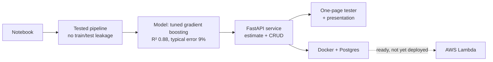

# King County house prices: from notebook to service

A working-but-fragile Jupyter notebook, refactored into a tested pipeline, a trustworthy
model and a small web service that anyone can try: answer six questions, get a price and
an honest range.



**Status:** everything runs locally and in Docker, and the AWS Lambda infrastructure is written and
validated, but **it has not been deployed**, so there is no live link yet. See
[docs/06-aws.md](docs/06-aws.md) for what is verified and what only a real deploy can prove.

**CI:** all four GitHub Actions jobs (checks, notebook, infrastructure, Docker stack) passed on their
first real run. (For the first commits GitHub refused to start any job over an account billing limit; every
check was run locally in the meantime, so nothing was waiting to fail.)

## Try it

```bash
uv sync --all-extras          # needs uv 0.13.5+ and Python 3.13 (see .python-version)
uv run kc-train               # trains and evaluates (about two minutes), writes artifacts/
uv run uvicorn kc_house.api.main:create_app --factory
```

Then open <http://localhost:8000> (the tester), `/presentation` (how it was built) and `/docs` (API).
Writes to `/api/houses` are refused unless you set a key: `KC_API_KEY=my-secret uv run uvicorn ...`.

With Docker (API plus a real Postgres, hardened):

```bash
cp .env.example .env          # then change the two secrets
docker compose up --build --wait
python3 scripts/smoke_test.py http://localhost:8000 --api-key "$(grep '^KC_API_KEY=' .env | cut -d= -f2)"
```

The notebook: open [King-County-refactored.ipynb](King-County-refactored.ipynb) with the `.venv` kernel.
The original is untouched in [King-County.ipynb](King-County.ipynb).

## Results

| | Held-out R² | Typical error |
|---|---|---|
| Predict by quality grade only (baseline) | 0.43 | |
| The notebook's model (polynomial ElasticNet), reproduced | 0.845 | 14.8% |
| **Tuned gradient boosting (shipped)** | **0.880** | **9.0%** |
| Six-question estimator (what the page uses) | 0.840 | 10.5% |

Under stricter splits the score holds: 0.881 with the same house never on both sides, 0.877 training on
the past and testing on the future. The page shows a price range that held the true price for 80.3% of
untouched test houses. Full detail, limits and a fairness note: [docs/model-card.md](docs/model-card.md).

## What this demonstrates, and where to look

| Practice | Evidence |
|---|---|
| **Refactor with proof, not hope** | notebook outputs frozen as golden values; the pipeline matches all 19 features to 1e-9 ([ADR-0002](docs/adr/0002-golden-master-parity.md), `tests/test_parity.py`) |
| **Find and fix leakage** | the notebook learned a feature from test rows; it is now a fitted step with a leakage test ([docs/01](docs/01-pipeline.md)) |
| **Compare models honestly** | baselines first, six models, the test set never used to tune, stricter splits ([docs/02](docs/02-training.md)) |
| **Measure uncertainty** | a calibrated 80% range, checked on held-out data |
| **API design** | factory, bounded inputs, closed-by-default writes, outage-tolerant ([docs/03](docs/03-api.md), [ADR-0005](docs/adr/0005-api-design.md)) |
| **Usable by non-engineers** | self-contained page, no outside requests, strict security headers ([docs/04](docs/04-web.md)) |
| **Containers done properly** | multi-stage, digest-pinned, trains inside the build, non-root, read-only ([docs/05](docs/05-containers.md)) |
| **Tested against reality** | a real Postgres, including stopping the database mid-run |
| **Infrastructure as code, tested** | CDK template with security assertions; no secret in the template ([docs/06](docs/06-aws.md)) |
| **Decisions on record** | seven short ADRs, each with a diagram ([docs/adr/](docs/adr/)) |
| **Automation** | workflows for lint, types, tests with Postgres, a notebook run, template tests and a full Docker stack (all passing); Dependabot watches dependencies |

137 automated tests (118 for the app, 19 for the infrastructure); 7 of the app tests run only when a Postgres URL or the notebook flag is set. About 99% of `src/` is covered.

## How the repository is organised

```
src/kc_house/        the package: cleaning, features, pipeline, models, training, estimator
  api/               FastAPI app, routers, secrets loading        web/  the page and the slides
tests/               unit, parity, leakage, API, real-Postgres, notebook
infra/               AWS CDK app and its tests
docs/                the story: problem -> idea -> design -> proof, plus ADRs and the model card
scripts/             baseline capture and the smoke test
Dockerfile, docker-compose.yaml, .github/workflows/
bonus_solution/      the course's reference example, left untouched
```

Start with [docs/README.md](docs/README.md) for the reading order, and
[docs/07-reflection.md](docs/07-reflection.md) for the answers to the project's three questions.

## Project brief, checked off

| Task | Where |
|---|---|
| Refactor cleaning and feature engineering into Python files | `src/kc_house/cleaning.py`, `features.py` |
| Reusable pipeline | `src/kc_house/pipeline.py` |
| Refactor the modeling step | `src/kc_house/models.py`, `train.py` (`uv run kc-train`) |
| FastAPI CRUD for houses (5 features) in a database | `src/kc_house/api/` |
| Dockerfile, run the app in a container | `Dockerfile`, `docker-compose.yaml` |
| Tests | `tests/`, `infra/tests/` |
| Beyond the brief | web page, slides, AWS Lambda infrastructure, CI, model card |

The dataset is the King County house sales file from the course template.
