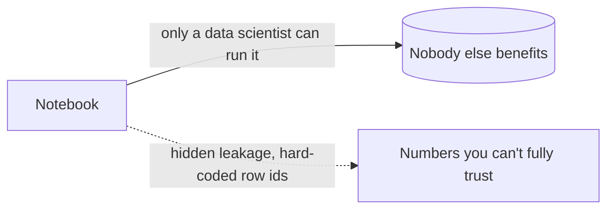
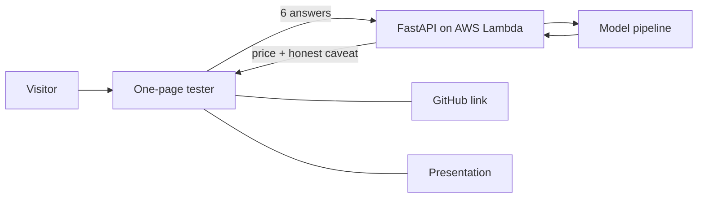

# 00 · Problem

## Who hurts, and why

A person moving to the Seattle area wants to know **what a house is worth**
before negotiating. Today the only working answer is a Jupyter notebook that:

- mixes exploration, cleaning, features and modeling in one linear script,
- can only be run by someone who understands pandas,
- leaks information between train and test (see below),
- cannot be called by an app, so nobody else can use the model.

## What we found in the notebook

| Finding | Why it matters | Our answer |
|---|---|---|
| `water_distance` is computed from every waterfront house, test rows included, before the split | Test data influences a training feature (leakage) | Fitted transformer: learns waterfront points from training rows only |
| A row is dropped by position (`drop(15856)`) | Breaks on any other dataset | Drop by rule: `bedrooms == 33` (training only) |
| Python loops over 21k rows (and 21k x 146 pairs) | Slow, hard to test | Vectorised code and a spatial index |
| Text says the target is price per sqft; code predicts `price` | Reader is misled | Follow the code: target is `price` |
| 177 house ids appear twice | A random split can put one house in train and test | Keep the notebook's split for parity, also report a split grouped by `id` |
| Model needs ~19 inputs | A person can't type that | A smaller "estimate" model with 6 plain questions |

## Product idea

One public link. A visitor answers six everyday questions and gets an
estimated price. The same page links to the code and to a short presentation
explaining how it was built.

## Success criteria (how we will prove it)

| Question | Proof |
|---|---|
| Is the refactor faithful? | Pipeline output matches the notebook's frozen numbers (`tests/golden/`) |
| Is it leak-free? | A test shows test rows cannot change any fitted value |
| Is the model honest? | Metrics, baselines and the accuracy lost by the 6-question model are published |
| Can a non-technical person use it? | The deployed link works end to end from a phone |
| Is it safe to be public? | Input validation, throttling, no open write endpoints |

## Out of scope

Neural networks (tabular data, and classical models clear the quality floor by a wide margin),
live data refresh, user accounts.

## Outcome

| Question | Result |
|---|---|
| Is the refactor faithful? | Yes: all 19 features equal the notebook's within 1e-9; the split is identical ([docs/01](01-pipeline.md)) |
| Is it leak-free? | Yes: the water feature is fitted on training rows only, with a test that proves it |
| Is the model honest? | Yes: baselines, six models, stricter splits, a model card with its weaknesses ([model card](model-card.md)) |
| Can a non-technical person use it? | Yes: <https://2y25p06my9.execute-api.eu-central-1.amazonaws.com/> (estimate, page and slides; no database in that deployment). The first request after idle takes about 17 s ([docs/06](06-aws.md)) |
| Is it safe to be public? | By design and by test, and checked live: anonymous writes refused (401), invalid input rejected (422), security headers present, secrets read from Secrets Manager. Not load-tested |
