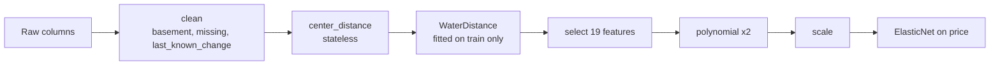

# 01 · Cleaning and feature pipeline

## Problem

The notebook's preparation steps were cells you had to run in order, with
state hidden in variables, loops over 21k rows and a leaky waterfront feature.

## Idea

Turn each step into a small tested function, chain them in one scikit-learn
`Pipeline`, and prove the result equals the notebook.

## Design

| Module | Holds |
|---|---|
| `cleaning.py` | pure functions, one per notebook cleaning step |
| `features.py` | `add_center_distance`, `select_model_features`, `WaterDistance` |
| `pipeline.py` | `build_preprocessing()` and `build_model_pipeline()` |
| `data.py` | load the CSV, notebook-identical 70/30 split |
| `config.py` | every constant (coordinates, hyperparameters, column list) |

## What changed from the notebook, and why

| Notebook | Pipeline | Effect |
|---|---|---|
| `drop(15856)` by position | rule: `bedrooms == 33`, training only | works on any data, never touches live requests |
| loop for `last_known_change` | vectorised `where` | same values |
| nested loops for `water_distance` (minutes) | NumPy in chunks, exact same formula | **0.08 s** for all 21k rows, same values |
| water reference points from **all** rows | from **training rows** only | removes test-to-train leakage |
| steps run on a global frame | one `Pipeline`, `clone`-able, skops-serialisable | usable by CV, training CLI and API |

## Proof

| Check | Result |
|---|---|
| All 19 feature columns vs notebook | equal to 1e-9 |
| Train/test split vs notebook | identical rows |
| Held-out R², notebook vs pipeline | 0.8443 vs 0.8447 (within 0.005; a gap this small is expected from learning the water feature on training rows only) |
| Leakage tests | transform-time rows cannot change learned references |
| skops save/load round trip | identical predictions |
| Tests | unit, parity, leakage and round-trip tests for every step; see the test suite |

## Known limits (honest list)

- `water_distance` in training rows is 0 for waterfront houses (each is in its own
  reference set). Matches the notebook and is redundant with the `waterfront` flag, but it
  means the model sees exact zeros in training that a new waterfront house will not have at
  serving time. Reported scores come from held-out rows, so they are honest; a
  leave-one-out reference set would remove the mismatch.
- The split is random, like the notebook. 177 house ids are sold twice, so a
  grouped split would be stricter; Phase 2 reports it alongside.
