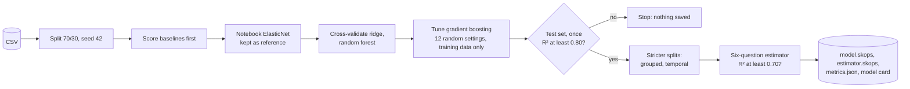

# 02 · Training, evaluation and the model card

## Problem

The notebook trained a model by hand, once. Nothing recorded which data, code or
settings produced the saved file, other model families were never tried, and the
score came from a single random split. A visitor to a website also cannot supply the
19 columns the model needs.

## Idea

One command trains, evaluates, saves and documents two models, and refuses to ship
either one below a stated floor:

- the **champion** (all 19 features), the most accurate model we can build, and
- the **six-question estimator**, which the website uses.

```bash
uv run kc-train --card docs/model-card.md
```

## Design



| Piece | Where |
|---|---|
| Baselines, reference, candidates, champion | `models.py` |
| Six-question estimator (zipcode defaults) | `estimator.py` |
| Metrics, errors by price band | `evaluate.py` |
| Notebook-identical, grouped and temporal splits | `data.py` |
| CLI, tuning, floors, provenance, saving | `train.py` |
| Model card rendered from `metrics.json` | `report.py` → `docs/model-card.md` |

## Decisions

- [ADR-0003](adr/0003-ship-gradient-boosting.md): ship gradient boosting, keep the
  notebook's ElasticNet as the documented reference.
- [ADR-0004](adr/0004-six-question-estimator.md): answer from six questions by
  filling the rest with zipcode medians.
- **Floors.** Held-out R² of at least 0.80 (champion) and 0.70 (estimator).
- **The test set never chooses or tunes anything.** Settings are chosen by
  cross-validation on training data. The test set is used to *report* scores (the
  champion, the baselines, the notebook's model, the estimator) and to check the two
  stopping floors. Other families are judged by cross-validation only.
- **Provenance in `metrics.json`**: git commit, data hash, seed, library versions.
- **Safe loading.** Each skops file is saved with the list of types it needs; the API
  loads with that explicit allow-list instead of trusting everything.

## Findings

| Question | Answer |
|---|---|
| Does the notebook model reproduce? | Yes: test R² 0.845, CV 0.828, same hyperparameters |
| Is the notebook model the best? | No. Tuned gradient boosting: test R² **0.880**, typical error **9.0%** of the price |
| Is the score inflated by split choice? | Not noticeably: grouped 0.881, temporal 0.877. Caveat: the settings were tuned on the random training split, so these two are slightly optimistic |
| What does asking only six questions cost? | R² 0.840 vs 0.880, typical error 10.5% vs 9.0% |
| Where does it err? | Full model: cheap houses overestimated by about $24k, top quartile underestimated by about $47k. The six-question model the page uses: about $29k and $52k |
| Is deep learning warranted? | No: tabular data, classical models clear the floor by a wide margin |

## Proof

The whole suite runs in about 15 seconds and covers about 99% of `src/`. It includes: the
reference grid search reaches the notebook's hyperparameters, a model below either floor is
never saved, the CLI exits non-zero on failure, saved models reload with their allow-lists
and predict, and a test proving the estimator trains on the same zip-filled rows it will see
when serving.
