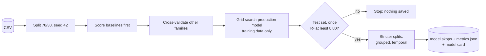

# 02 · Training, evaluation and the model card

## Problem

The notebook trained a model by hand, once. Nothing recorded which data, code or
settings produced the saved file, other model families were never tried, and the
score came from a single random split.

## Idea

One command trains, evaluates, saves and documents the model, and refuses to
ship anything below a stated floor.

```bash
uv run kc-train --card docs/model-card.md
```

## Design



| Piece | Where |
|---|---|
| Baselines and candidate families | `models.py` |
| Metrics, errors by price band | `evaluate.py` |
| Notebook-identical, grouped and temporal splits | `data.py` |
| CLI, grid search, floor, provenance, saving | `train.py` |
| Model card rendered from `metrics.json` | `report.py`, output in `docs/model-card.md` |

## Decisions

- **Stopping floor.** Held-out R² of at least 0.80 (`config.MIN_ACCEPTABLE_R2`).
  The notebook reaches 0.84; the grade-only baseline 0.43.
- **Test set touched once**, for the tuned model. Other families are judged by
  cross-validation so they cannot overfit the test set.
- **Provenance in `metrics.json`**: git commit, data hash, seed, library versions.
- **Safe loading.** The skops file is saved with the list of types it needs; the API
  loads with that explicit allow-list instead of trusting everything.

## Findings

| Question | Answer |
|---|---|
| Does the notebook model hold up? | Yes: test R² 0.845, matching the notebook |
| Is it leaky or lucky? | Grouped split 0.835, temporal split 0.812: slightly lower, still above the floor |
| Is it the best model? | **No.** Gradient boosting scores 0.883 in cross-validation, random forest 0.869, the notebook's ElasticNet 0.828 |
| Where does it err? | Cheap houses overestimated by about $41k, the top quartile underestimated by about $54k |
| Is deep learning warranted? | No: tabular data, classical models clear the floor; tuned trees come first |

## Open decision

The notebook model stays the shipped default for fidelity. Switching the champion
to a tuned gradient-boosted model would add about 0.05 R² at the cost of a model
that is harder to explain than a linear one. See the summary for the recommendation.

## Proof

40 tests, 99% coverage of `src/`. Includes: the grid search reaches the notebook's
hyperparameters (`alpha=0.01`, `l1_ratio=0.2`, CV R² within 0.01), a model below the
floor is never saved, the CLI exits non-zero on failure, and a saved model reloads
and predicts.
