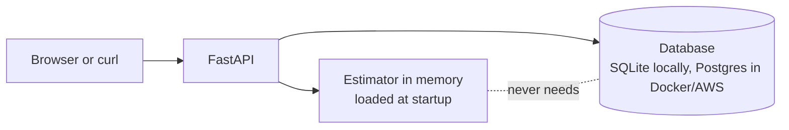

# 03 · The API

## Problem

The model lives in a file. Nobody else can use it, and the brief asks for an app
that creates, reads, updates and deletes houses (five features) in a database.

## Idea

One small service that does two jobs:

1. **Estimate** a price from six everyday answers, with an honest range.
2. **Keep houses** (bedrooms, bathrooms, living area, grade, zip code) in a
   database, and estimate any stored house.

## Design



Decisions and trade-offs are in [ADR-0005](adr/0005-api-design.md).

| Endpoint | Purpose | Needs key |
|---|---|---|
| `POST /api/estimate` | Six answers in, price and 80% range out | no |
| `GET /api/zipcodes` | The 70 supported zip codes | no |
| `GET /api/meta` | Model quality and inputs, for the web page | no |
| `GET /api/health` | Model and database status | no |
| `GET /api/houses` | List, `limit` and `offset` | no |
| `GET /api/houses/{id}` | Read one | no |
| `GET /api/houses/{id}/estimate` | Estimate a stored house | no |
| `POST /api/houses` | Create | **yes** |
| `PUT /api/houses/{id}` | Replace | **yes** |
| `DELETE /api/houses/{id}` | Delete | **yes** |

Interactive documentation is generated at `/docs`.

## Run it locally

```bash
uv sync --all-extras
uv run kc-train                      # about two minutes, writes artifacts/
KC_API_KEY=my-secret uv run uvicorn kc_house.api.main:create_app --factory
```

```bash
curl -X POST localhost:8000/api/estimate -H 'Content-Type: application/json' \
  -d '{"bedrooms":3,"bathrooms":2,"sqft_living":1800,"grade":7,"zipcode":98103}'
```

Checked live on the real model:

| House | Estimate | 80% range |
|---|---|---|
| 3 bed, 2 bath, 1,800 sq ft, grade 7, Seattle 98103 | $602,000 | $469,000 to $735,000 |
| 5 bed, 4 bath, 4,500 sq ft, grade 11, waterfront, Medina 98039 | $3,405,000 | $2,654,000 to $4,155,000 |

## How the price range is made

The estimate is multiplied by **0.78** and **1.22**. These multipliers were measured
on out-of-fold predictions of the training data, so they use no test data. On the
untouched test set the range held the true price for **80.3%** of houses, matching
the 80% target.

## Failure behaviour (all tested)

| Situation | Result |
|---|---|
| No model file at startup | app refuses to start, message says to run `kc-train` |
| Database unreachable | estimates still work; `/api/houses` returns 503; health says `database: unavailable` |
| Write without a key | 401; with no key configured at all, 403 |
| Out-of-range answer (for example grade 99) | 422 naming the field |
| Zip code the model never saw | 422 pointing to `/api/zipcodes` |

## Proof

26 API tests (about one second, no Postgres needed) cover estimates, validation, the
full CRUD cycle, pagination, access control, database outage, startup failure and
request ids. Whole suite: 77 tests, 99% coverage of `src/`. The Postgres branch is
checked against a real Postgres in the Docker phase.
