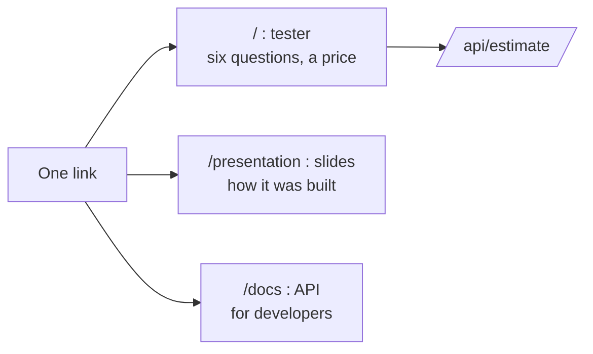

# 04 · The web page and the presentation

## Problem

A model behind an API is invisible to most people. A hiring manager, a recruiter or a
home buyer will not read OpenAPI docs. They need a link they can click and use, plus
the story of how it was built.

## Idea

One public address, three things behind it:

All served by the same FastAPI app, so there is one thing to deploy.

## Design

| Choice | Why |
|---|---|
| Plain HTML, CSS and JavaScript, no framework, no build step | nothing to install or break; loads instantly; nothing external to go down |
| Self-contained: no fonts, scripts or images from other sites | works offline and on a locked-down network; lets the security policy forbid everything else |
| Strict Content-Security-Policy, `nosniff`, no referrer | a public page should not be injectable or embeddable |
| Relative URLs (`api/estimate`) | works behind any path prefix, which API Gateway may add |
| Examples as one-click chips | a first-time visitor sees a result in two clicks |
| Plain-language quality choices (Basic to Luxury) | a non-expert does not know what "grade 8" means |
| Result shows a range, the share of houses that fell in it, and a caveat | honest about uncertainty, not a falsely exact price |
| Answers to errors in words ("Pick a zip code from the list") | no stack traces, no codes |
| Light and dark theme, keyboard and screen-reader friendly, no horizontal scroll on a phone | usable by everyone |

The slides are a 13-slide deck written as one HTML file: arrow keys, swipe, deep
links (`/presentation#8`), and print to PDF. They follow the same loop as every phase:
problem, idea, design, build, proof, reflection.

## Proof

- Verified in a real browser at desktop and phone width: example chips fill the form,
  the estimate returns in about 20 ms warm, the range bar and caveat appear, no
  horizontal overflow on a 375 px screen.
- 12 automated page tests: security headers, `HEAD` support, no request to any other
  website, every element the script looks up exists, only grades the API accepts, and
  the deck's notebook score equals the frozen baseline.
- Both pages are included in the built package, so the Docker image carries them.

## Known limits

- Slide numbers are typed in, not generated. A test ties the notebook score to the
  frozen baseline; the model numbers are copied from `docs/model-card.md` and must be
  refreshed after retraining.
- The deck marks the container and AWS deployment as "next"; update after Phase 5.
