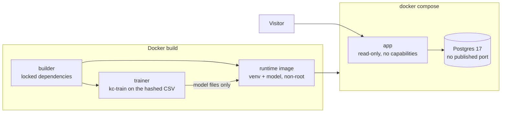

# 05 · Containers and the real database

## Problem

"It works on my machine" is not a deliverable. The service must run the same way
anywhere, the model in it must match the code, the database path must be tested for
real (SQLite hides Postgres differences), and a public service must not run with more
power than it needs.

## Idea

One image that trains its own model, runs as an unprivileged user with nothing
writable, and a Compose file that starts it next to a real Postgres.

## Design



| Choice | Why |
|---|---|
| Multi-stage build; runtime has no compiler, no dev tools, no training data | smaller attack surface, smaller image |
| Model trained **inside the build** from the same code and the hashed dataset | the image can never carry a model that does not match its code; training is deterministic (the in-image run reproduced the laptop's 0.8799 / 0.8403 exactly) |
| Base images pinned by digest; Dependabot proposes updates | reproducible builds, still patched |
| Dependency layer before source layer, BuildKit cache mounts | rebuilds after a code change skip the slow downloads |
| User `app` (uid 10001), code owned by root | the process cannot modify its own code |
| Compose: `read_only`, `cap_drop: ALL`, `no-new-privileges`, tmpfs `/tmp` | the container can do almost nothing if it is ever compromised |
| Database has no published port; secrets come from a gitignored `.env`; compose refuses to start without them | nothing exposed, nothing weak by default |
| `HEALTHCHECK` and `depends_on: service_healthy` | the app starts only when Postgres is ready, and `docker ps` shows when it stops answering. Docker itself does not restart an unhealthy container (Compose's `restart` reacts only to the process exiting); an orchestrator would act on the signal |

Decision record: [ADR-0006](adr/0006-container-image.md).

## Run it

```bash
cp .env.example .env        # then change the two secrets
docker compose up --build --wait
python3 scripts/smoke_test.py http://localhost:8000 --api-key "$(grep '^KC_API_KEY=' .env | cut -d= -f2)"
```

Open `http://localhost:8000` (tester), `/presentation`, `/docs`. The first build takes
about three minutes because it trains the model.

## Proof (all run on the real stack)

| Check | Result |
|---|---|
| Smoke test through the container | 13 of 13 pass (health, estimate, both pages, validation, refused anonymous write, create / read / estimate / delete) |
| Process identity | `uid=10001(app)`; effective capabilities `0000000000000000`; `NoNewPrivs: 1` |
| Writing to `/app` or the virtualenv | refused: "Read-only file system" |
| Postgres schema | `houses` table, integer and double precision columns, index on `zipcode` |
| Restart the app | the stored house is still there |
| `down` then `up` (volume kept) | the stored house is still there |
| **Stop the database** | health: `ok`, `database: unavailable`; estimates still return 200; `/api/houses` returns 503 |
| **Start the database again** (app not restarted) | everything returns to 200 on its own |
| **Freeze the database** (`docker pause`: connections hang instead of failing) | health answers in 2.0 s with `database: unavailable`, estimates stay at 200, `/api/houses` returns 503 in 2.0 s, recovery is instant. Found by review and fixed: a pooled connection used to hang the health check for 30 s+ (see ADR-0005) |
| Real-Postgres tests (6) | pass against Postgres 17: CRUD, exact number round trips, ids never reused, pagination order, data outlives the app |
| Image size | 805 MB (469 MB is the scientific Python stack) |

## Known limits

- Any change under `src/` retrains the model during the next build (about three
  minutes). Accepted: correctness over speed.
- Vulnerability scanning is not in place yet. It belongs with the deployment
  hardening, where an image scan will gate the release.
- The CI `stack` job mirrors these steps (build, start, smoke test) and passed on GitHub's
  runners. It does not repeat the frozen-database check, which was run locally.
