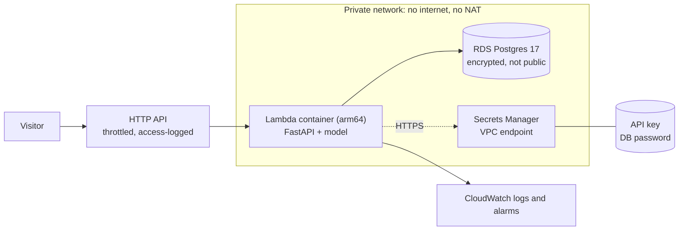

# 06 · AWS Lambda deployment

> **Status: written and validated, not deployed.** Nothing in this repository has been
> sent to AWS. Everything below marked "verified" was checked locally; everything marked
> "not verified" can only be proven by a real deploy.

## Problem

The service runs in Docker on one laptop. A visitor needs a public link that works
without anyone's machine being on, without paying for an idle server, and without a
public database or a secret sitting in a config file.

## Idea

Serverless. A container image on AWS Lambda behind an HTTP API gives one public URL and
costs almost nothing when idle. Postgres lives in a private network that only the
function can reach.

## Design



Two modes, chosen with `-c database=...`:

| Mode | Contains | Estimates and pages | `/api/houses` | Rough cost |
|---|---|---|---|---|
| `rds` (default) | Lambda, private VPC, RDS Postgres, Secrets Manager endpoint | work | work | about $22 to $25 a month |
| `none` | Lambda and the API only | work | answer 503 by design | about $1 a month |

Cost figures are estimates from public list prices (db.t4g.micro about $12, 20 GB storage
about $2.5, the interface endpoint about $7.5, two secrets $0.80, everything else near
zero at demo traffic). Prices vary by region; check the AWS pricing pages before
deploying. Tear the stack down when you are done (below).

Decisions and rejected alternatives: [ADR-0007](adr/0007-aws-architecture.md).

## Security properties (tested in `infra/tests`)

| Property | How it is enforced |
|---|---|
| No secret in the template or in an environment variable | the function gets **secret ARNs** and reads the values itself at start-up |
| Database is never public | private isolated subnets, `PubliclyAccessible: false`, no internet gateway, no NAT, no routes |
| Only the function can reach Postgres and the endpoint | security-group rules reference the function's group, never an address range; no `0.0.0.0/0` anywhere in the template |
| Least privilege | the function's role may only `GetSecretValue` / `DescribeSecret` on its own two secrets (plus the AWS-managed network-interface role) |
| Encrypted at rest | `StorageEncrypted: true`; TLS to Postgres (`sslmode=require`) |
| Abuse and cost control | API-wide throttle of 10 requests a second (burst 20); no provisioned concurrency unless asked; log retention one month |
| Writes closed by default | needs the generated API key; the app refuses to start if a configured secret cannot be read |
| Observability | JSON logs with request ids, API access logs, alarms on function errors and API 5xx, optional email and monthly budget alert |

## How to deploy (you run these; nothing here runs automatically)

Prerequisites: an AWS account and credentials you trust on this machine, Docker running,
Node.js 22 or 24 (Node 26 works but prints a warning from the CDK runtime), and about 45
minutes the first time (the image build trains the model).

```bash
cd infra
uv sync
npx aws-cdk@2 bootstrap                      # once per account and region
npx aws-cdk@2 diff -c database=rds           # read what will be created
npx aws-cdk@2 deploy -c database=rds -c git_sha="$(git rev-parse HEAD)" -c alert_email=you@example.com
```

The deploy prints `ApiUrl` (the public link) and `GetApiKeyCommand`. Then:

```bash
python3 scripts/smoke_test.py "<ApiUrl>" --api-key "<value from GetApiKeyCommand>"
```

Cheapest variant, no database: `-c database=none`. Other options: `memory_mb`,
`throttle_rate`, `throttle_burst`, `provisioned_concurrency` (keeps instances warm, costs
money while idle), `budget_usd`, `github_url`, `postgres_version`.

**Tear down** (removes everything, including the database, which has no deletion
protection on purpose so a demo is easy to remove):

```bash
npx aws-cdk@2 destroy
```

A manual GitHub workflow ([deploy.yml](../.github/workflows/deploy.yml)) does the same
through short-lived OIDC credentials; it needs one-time setup of an IAM role and an
approval environment.

## What is verified, and what is not

| | Status |
|---|---|
| Template security properties (19 tests) | verified: no secret values, private encrypted database, no `0.0.0.0/0`, least-privilege IAM, throttling, retention, both modes, options |
| The Lambda image target (arm64) | verified locally: builds in about 5 minutes, 860 MB, adapter present and executable, boto3 present; the app starts read-only with no Linux capabilities and passes the smoke test 9 of 9 in database-less mode |
| Secrets loading (escaping, failure handling, start-up wiring) | verified with 7 unit tests and a fake Secrets Manager |
| Lambda Web Adapter serving real API Gateway events | **not verified**: only a real invoke proves it |
| Cold-start time, memory sizing, throttle values | **not verified**: measure after deploy; expect a few seconds on a cold start |
| Cross-AZ access to the single-AZ Secrets Manager endpoint | **not verified** |
| CloudFormation syntax and semantics (`cfn-lint`, both modes) | verified: no errors. One warning (W3691) says engine version `17` may be rejected by RDS; if so, deploy with `-c postgres_version=<supported minor>` |
| GitHub deploy workflow and OIDC role | **not verified**: needs your account |

## Known limits and next steps

- Single-AZ database, one-day backups: right for a demo, wrong for real data.
- No custom domain and no WAF (about $5 a month and up): add both before real traffic.
- The function and the stack share one AWS account; production would separate them.
- Image vulnerability scanning is not in place; enable ECR scanning or add a scan to CI
  before relying on this publicly.
