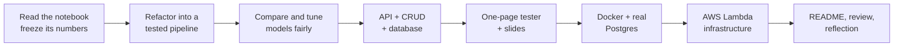

# 07 · Reflection

The project brief ends with three questions. These are honest answers, including the
parts that did not go smoothly.

## 1. What steps did you take to complete the project?

1. **Read before touching.** I read the notebook end to end, wrote down what was wrong
   with it ([docs/00](00-problem.md)), and ran its own cells once to freeze its results as
   golden values. This is the step that made everything else safe.
2. **Refactor with a proof.** Each cleaning and feature step became a small pure function;
   the whole thing became one scikit-learn pipeline. The golden values became a parity
   test: all 19 features equal to the notebook's within 1e-9.
3. **Treat modeling as an experiment.** Baselines first, six models compared under the
   same preprocessing, the test set never used to choose or tune, stricter splits as a sanity check, a model
   card generated from the numbers.
4. **Make it usable.** An API that estimates a price and stores houses, then a one-page
   tester for non-technical visitors and a short presentation.
5. **Make it deployable.** A hardened container that trains its own model, tested against
   a real Postgres; then AWS Lambda infrastructure with security assertions.
6. **Document as I went.** Every phase wrote a short problem, idea, design and proof
   document; every real decision got a one-page decision record with a diagram.

## 2. What challenges did you face?

| Challenge | What happened | What I did |
|---|---|---|
| **Leakage hidden inside a feature** | the water-distance feature used every waterfront house, test rows included, and was built before the split | turned it into a fitted step that learns from training rows only, and wrote a test that proves test rows cannot change it |
| **Text and code disagreed** | the notebook's prose said it predicted price per square foot; the code predicts price | followed the code, listed the mismatch in the findings |
| **The obvious model was not the best** | the notebook's ElasticNet scored 0.83 in cross-validation; gradient boosting scored 0.89 | reproduced the notebook first, then switched with evidence and kept the original as the documented reference ([ADR-0003](adr/0003-ship-gradient-boosting.md)) |
| **Users cannot supply 19 inputs** | the model needs lot size, view, coordinates and more | built a six-question estimator that fills the rest from zip-code medians, measured what that costs (0.040 R²), and calibrated an honest price range ([ADR-0004](adr/0004-six-question-estimator.md)) |
| **A public page needs safe defaults** | open write endpoints are unsafe on a public link | writes are closed unless a key is configured; estimates never need the database, so an outage does not take the demo down |
| **Tests told me something was wrong** | infrastructure tests found default security groups that were wider than needed; a smoke test would have flagged a correct database-less deploy as failing | tightened the template and added a `--no-database` mode |
| **Slow feedback** | the first API tests took 146 seconds because of large boosting searches | tests use a tiny search space: 7 seconds |
| **Tooling friction** | the installed `uv` was too old for the lockfile requirement; a test client library had been superseded; Node 26 is newer than the CDK runtime supports | updated or worked around each, and wrote the version notes into the docs |
| **A frozen database hung the health check** | an independent review suspected it; I reproduced it by freezing a real Postgres: `/api/health` hung 30 s+ on a re-used pooled connection | unpooled connections with a 2-second connect timeout; re-measured: health answers in 2.0 s, recovery is instant ([ADR-0005](adr/0005-api-design.md)) |
| **Docs that claimed more than the code** | the same review found a false healthcheck claim, an estimator described as trained on full rows (it is trained on zip-filled rows), stale test counts, and "test set used once" where it is also used to report several scores | corrected each, and strengthened the tests that could not have failed |
| **CI never ran** | GitHub refused to start any job: "recent account payments have failed or your spending limit needs to be increased" | none of the workflows has run yet. I ran every check locally and said so in the README rather than claim a green pipeline |
| **Proving things I cannot run** | I did not deploy to AWS, so some behaviour is unproven | the runbook lists exactly what is verified (template, image, secrets code) and what only a real deploy can show (adapter on real events, cold start) |

## 3. What would you do differently with more time?

In rough order of value:

1. **Deploy it and measure.** A live link, a smoke test against it, real cold-start times,
   and a small load test to choose the memory size and throttle values. Today those are
   educated guesses.
2. **Get CI running.** Resolve the account billing block, then watch the first runs; there
   will be small fixes, because the workflows have never executed.
3. **A fairness audit.** Zip code and coordinates can stand in for neighbourhood
   demographics. I flagged this in the model card but did not measure it.
4. **Explain each prediction.** Show a visitor which of their answers moved the price
   (SHAP values), not only the price.
5. **Better uncertainty.** The 80% range is one global multiplier. Per-segment intervals
   (conformal or quantile models) would be tighter for cheap houses and honest about
   expensive ones.
6. **Database migrations.** `create_all` is fine for one five-column table; the next schema
   change should come with Alembic.
7. **Monitoring and retraining.** The data is from 2014 to 2015. A real service needs drift
   checks, a retraining trigger and a model registry instead of "train in the image build".
8. **Harden the supply chain.** Image vulnerability scanning, signed images, and a WAF and
   custom domain before any real traffic.
9. **A geographic hold-out.** Test on neighbourhoods the model never saw, the strictest
   check of whether it generalises.

## What I would tell myself at the start

Freeze the baseline before refactoring anything, and measure before believing: the three
most useful moments in this project were a parity test that proved the refactor, a model
comparison that disproved the notebook's choice, and a security test that disproved my
own first draft of the network.
