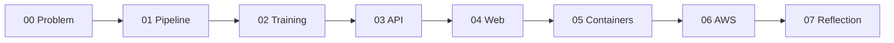

# Documentation

Each numbered document follows the same shape: **problem, idea, design, proof**.
Read them in order, or jump to the one you need.

| Read | Answers |
|---|---|
| [00 · Problem](00-problem.md) | Who hurts, what we found in the notebook, what success means |
| [01 · Pipeline](01-pipeline.md) | How notebook steps became one tested pipeline, and the proof it matches |
| [02 · Training](02-training.md) | How models are compared, tuned, evaluated and saved |
| [Model card](model-card.md) | The model's performance, limits and honest weaknesses (generated) |
| [03 · API](03-api.md) | Endpoints, safety defaults, failure behaviour |
| [04 · Web](04-web.md) | The one-page tester and the slides |
| [05 · Containers](05-containers.md) | The image, Compose, and the real-Postgres checks |
| [06 · AWS](06-aws.md) | The Lambda infrastructure, runbook, cost, and what is not yet verified |
| [07 · Reflection](07-reflection.md) | Steps, challenges and what I would do with more time |
| [Decisions](adr/) | Seven architecture decision records (ADRs), each with a diagram |

The model card is generated by `uv run kc-train` from `metrics.json`; do not edit it by hand.
