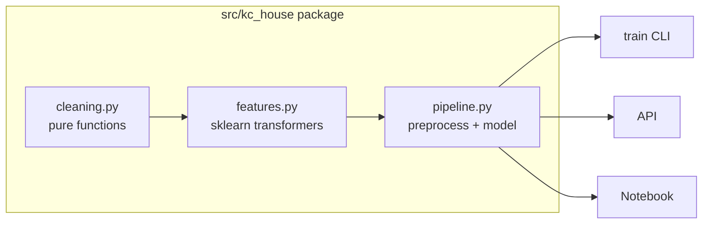

# ADR-0001 · One installable package, one scikit-learn pipeline

Status: accepted

## Context

Cleaning and features lived in notebook cells. The API must apply the exact
same steps at prediction time, or predictions silently drift (train/serve skew).

## Decision

- Stateless steps (fix `?`, fill missing, `last_known_change`, distance to the
  wealth centre) are plain functions wrapped in `FunctionTransformer`.
- Stateful steps (distance to water) are real transformers with `fit`/`transform`,
  so they learn only from training data.
- Everything is one `Pipeline`; the training CLI, the API and the notebook all import it.
- Row filtering (the 33-bedroom record) happens before the pipeline, in training only.

## Consequences

- (+) Single source of truth, easy to unit test, can be cloned and cross-validated.
- (+) Leakage is prevented by construction.
- (-) Slightly more code than a script; worth it for correctness.
