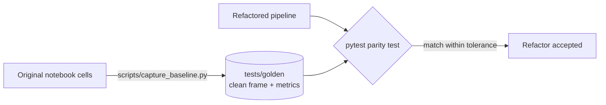

# ADR-0002 · Prove the refactor with frozen notebook output

Status: accepted

## Context

A refactor is only safe if behaviour is unchanged. "It looks right" is not proof.

## Decision

1. Run the notebook's own cells once, verbatim, and freeze the cleaned frame and
   key scores in `tests/golden/`.
2. The refactored pipeline must reproduce them (numeric tolerance, not bit equality).
3. Deliberate behaviour changes (for example fixing leakage) are listed in
   `docs/` with before/after numbers, never hidden inside the refactor.

## Consequences

- (+) Reviewers can verify the refactor in one command.
- (-) Golden files must be regenerated, with a note, if a change is intentional.
