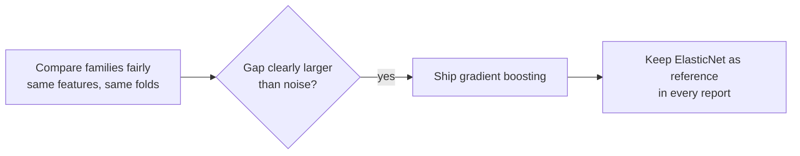

# ADR-0003 · Ship gradient boosting; keep the notebook model as the reference

Status: accepted

## Context

The notebook's polynomial ElasticNet is the "obvious" model for a refactoring
exercise. Comparing families under the same preprocessing showed it is not the best.

| Model | Cross-validated R² |
|---|---|
| Ridge | 0.739 |
| Notebook ElasticNet | 0.828 |
| Random forest | 0.869 |
| Tuned gradient boosting | 0.886 |

The gap (0.058) is several times the fold-to-fold noise (about 0.01 to 0.02).

## Decision

Ship `HistGradientBoostingRegressor`, tuned by random search on training data only.
The notebook's ElasticNet stays in the code, the comparison table and the model
card, so the refactor can still be checked against the original.

## Consequences

- (+) Typical error falls from about 14.8% to 9.0% of the price.
- (+) Honest story: the notebook was reproduced first, then beaten with evidence.
- (-) Less directly interpretable than a linear model. Mitigated by the error
  breakdown and by keeping the linear reference.
- (-) Slower to train (about two minutes). Irrelevant at serving time.
