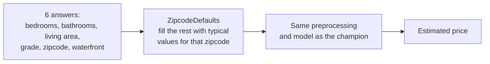

# ADR-0004 · Answer from six questions by filling in zipcode defaults

Status: accepted

## Context

The model needs 19 columns (lot size, view, condition, coordinates ...). A visitor to
the public page, and the CRUD resource in the brief (5 stored features), can supply
only a few plain facts.

## Decision

- `ZipcodeDefaults` learns the median of nine unknown columns per zip code from
  **training rows only**.
- No basement and no renovation are assumed.
- The estimator is trained on the same degraded inputs it will see at serving time, so
  it learns what a six-answer house looks like.
- Unknown zip codes are rejected with a clear message rather than guessed.

## Consequences

- (+) One preprocessing path for everything; no second, hand-written feature code.
- (+) Cost is measured, not assumed: R² 0.840 vs 0.880 for the full model.
- (-) Two houses with identical answers get identical estimates, even if one has a
  view or a big lot. The page says so.
