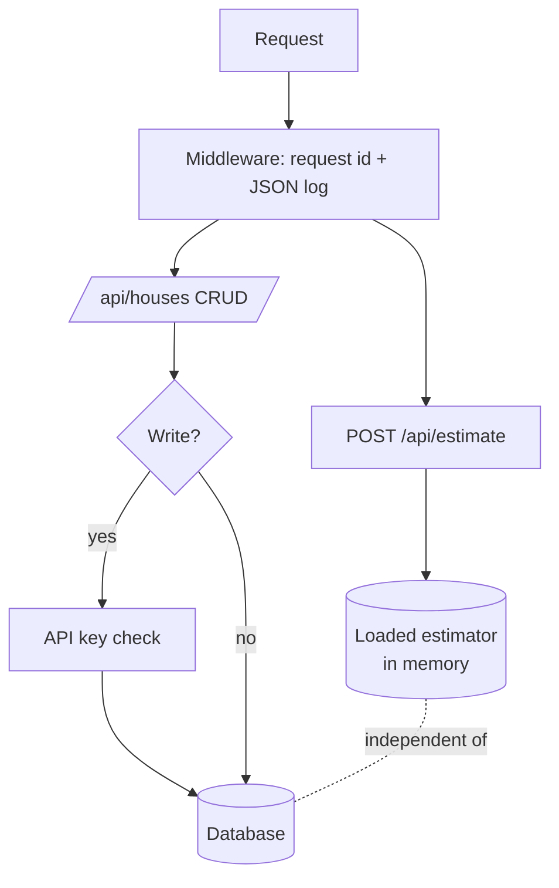

# ADR-0005 · API design: factory, optional database, closed writes

Status: accepted

## Context

The reference solution connects to the database when the module is imported, creates
tables there, and has open write endpoints. That cannot be tested without Postgres,
and it would be unsafe on a public URL. Our service must also run on AWS Lambda,
where the database may be slow, far away, or absent.

## Decision

| Choice | Why |
|---|---|
| `create_app()` factory, settings from `KC_*` env vars | tests build an app with a temp database; nothing connects at import |
| Model loaded at startup; app refuses to start without it | a service that cannot estimate must never look healthy |
| Estimate does not touch the database | the public demo keeps working when the database is down (tested) |
| Database failure returns 503, health reports `database: unavailable` | clear signal, no stack traces |
| Writes refused unless an API key is configured; the key is compared in constant time | a public URL must not accept anonymous writes |
| Input bounds come from the training data (for example grade 3 to 13) | the model is never asked about houses unlike its training data |
| Unknown zip code returns 422 with a pointer to `/api/zipcodes` | tells the caller what to do instead of guessing |
| JSON logs with a request id; safe incoming ids are kept | traceable in CloudWatch |
| Tables created at startup, no migrations yet | one five-column table; Alembic is the next step once the schema changes |

## Consequences

- (+) 26 API tests run in about a second with no Postgres.
- (+) Safe by default: no key means read-only.
- (-) `create_all` is not a migration tool. Acceptable for this schema; revisit when a
  second table or a column change appears.
