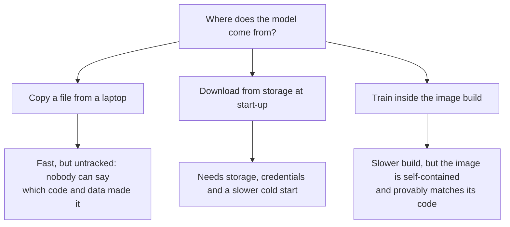

# ADR-0006 · Train the model inside the image build; run it with almost no privileges

Status: accepted

## Context

The service needs a model file. Where it comes from decides whether the deployed model
can drift from the deployed code, and how reproducible a release is.

## Options

## Decision

Train inside the build (option C), in its own stage, and copy **only the model files**
into the runtime image. Training is seeded, so the same inputs produce the same model;
the in-image run reproduced the local metrics exactly.

Run the container as a non-root user, with a read-only filesystem, no Linux
capabilities and no new privileges. The database is reachable only on the Compose
network.

## Consequences

- (+) One immutable artefact per commit; the commit is recorded in the model metadata.
- (+) No model storage, no credentials, no download at cold start. This matters on
  AWS Lambda.
- (-) A source change retrains (about three minutes). Acceptable at this size; revisit
  with a model registry if training grows.
- (-) The image is 805 MB. Fine for Lambda container images (limit 10 GB).
