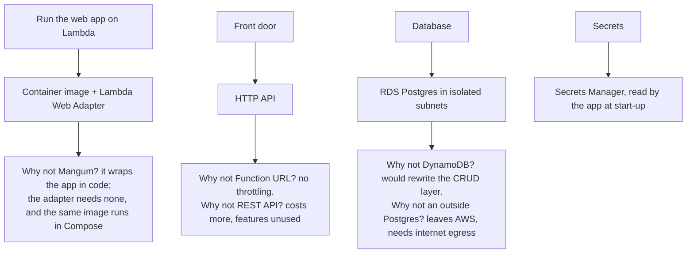

# ADR-0007 · AWS architecture: Lambda container, HTTP API, private RDS

Status: accepted. Deployed in `none` mode on 2026-10-28; `rds` mode written and tested but not yet deployed.

## Context

One public link, near-zero idle cost, no public database, no secret in a config file, and
a design a reviewer can verify from the template alone.

## Decisions

| Choice | Reason | Cost of the choice |
|---|---|---|
| Container image, not a zip | pandas, scikit-learn and scipy exceed the 250 MB zip limit; one image for Compose and Lambda | longer builds (the image trains the model) |
| arm64 (Graviton) | cheaper per millisecond, and the image already builds natively on Apple Silicon | Intel machines need emulation or the arm64 CI runner |
| Lambda Web Adapter | the web app stays an ordinary web app | one extra binary in the image; behaviour only provable on AWS |
| HTTP API with stage throttling | cheap, simple, caps abuse and cost | coarse, API-wide limits |
| Isolated subnets, no NAT | NAT gateways cost about $32 a month and are not needed | needs an interface endpoint for Secrets Manager (about $7.5 a month) |
| Secret **ARNs** in the environment, values read at start-up | secrets never appear in the template, the console or the function configuration | adds boto3 to the image and about 100 ms to a cold start |
| `database=none` mode | a one-dollar deployment of the part visitors actually use | CRUD returns 503 by design |
| No deletion protection, `DESTROY` removal | a demo must be removable in one command | must be reversed for real data |

## Consequences

- (+) Idle cost is near zero in `none` mode, and about $22 a month with the database.
- (+) Security claims are asserted by tests against the synthesised template.
- (-) Cold start is long: about 17 s for the first request after idle (measured on the
  first deploy). The adapter and the secret loading are proven live; cross-AZ endpoint
  access and the database path are still unproven because `rds` mode is not deployed.
- Revisit when: real data is stored (multi-AZ, backups, deletion protection), traffic is
  public (WAF, custom domain, alarms with an on-call), or cold starts hurt (provisioned
  concurrency, smaller image).
