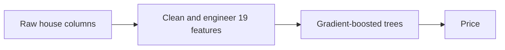

# Model card: King County house price estimator

Generated by `kc_house.train` on 2026-10-28T14:29:34+00:00 (git `e7d5a1b`).
Every number below comes from `metrics.json`; do not edit by hand.

## Intended use

Give a rough sale-price estimate for a house in King County, Washington, to help a
buyer or seller judge a fair price. **Not** for appraisal, lending, insurance or any
decision with legal or financial consequences.

## Data

21,597 house sales from 2014-05-02 to 2015-05-27 (one year); one implausible
record is removed. Split 15,117 train / 6,479 test,
seed 42. Dataset hash `73e8f351aada`.

## Model

Gradient-boosted trees, tuned by 12 random
settings with 5-fold cross-validation on training data
only. Chosen settings:

- `l2_regularization`: 0.1
- `learning_rate`: 0.05
- `loss`: squared_error
- `max_iter`: 600
- `max_leaf_nodes`: 31
- `min_samples_leaf`: 20

The notebook's polynomial ElasticNet stays in the comparison as the documented
reference.

## Performance (held-out test set, used once to judge the champion)

| Metric | Value |
|---|---|
| R² | 0.880 |
| Typical error (median) | 9.0% of the price |
| Mean absolute error | $66,679 |
| RMSE | $126,121 |
| Average bias | -$3,221 |

Stopping floor: held-out R² of at least 0.80. Met.

## What it beat

| Model | Role | Cross-validated R² | Test R² |
|---|---|---|---|
| `mean_baseline` | baseline | 0.000 ± 0.000 | 0.000 |
| `grade_only_linear` | baseline | 0.451 ± 0.011 | 0.432 |
| `elastic_net_poly` | reference | 0.828 ± 0.012 | 0.845 |
| `ridge` | candidate | 0.739 ± 0.012 | not used |
| `random_forest` | candidate | 0.869 ± 0.009 | not used |
| `hist_gradient_boosting` | production | 0.886 ± 0.018 | 0.880 |

Baselines are scored before any tuning. Candidates are judged on cross-validation
only. The reference's test score is reported for information, not used to choose.

## How honest is the number? (stricter splits)

| Split | R² | Mean abs error | Typical error |
|---|---|---|---|
| random (notebook) | 0.880 | $66,679 | 9.0% |
| grouped by house id | 0.881 | $68,103 | 8.7% |
| temporal (train past, test future) | 0.877 | $73,732 | 10.0% |

*Grouped* keeps the same house out of both sides (177 houses sold twice).
*Temporal* trains on earlier sales and tests on later ones, like real use.

## Where it errs (price quartiles, test set)

| Quartile | Price range | Houses | Typical error | Average bias |
|---|---|---|---|---|
| 1 | $82,000 to $320,000 | 1644 | 10.1% | $23,835 |
| 2 | $320,900 to $450,000 | 1610 | 8.1% | $10,836 |
| 3 | $450,500 to $640,000 | 1617 | 8.5% | -$1,240 |
| 4 | $640,500 to $7,060,000 | 1608 | 9.8% | -$46,951 |

The model pulls estimates toward the middle: cheap houses tend to be overestimated and the most expensive underestimated.

## The six-question estimator (what the website uses)

A visitor answers 6 everyday questions: `bedrooms`, `bathrooms`, `sqft_living`, `grade`, `zipcode`, `waterfront`. Everything
else is filled with what is typical for the house's zip code, learned from training
data only (no basement and no renovation assumed).

| Metric | Value |
|---|---|
| R² | 0.840 |
| Typical error (median) | 10.5% of the price |
| Mean absolute error | $79,215 |
| RMSE | $145,475 |
| Average bias | -$852 |

Accuracy given up by asking six questions instead of 19 columns: **0.040 R²**.
Floor for this model: 0.70. Met.

## Limitations

- Prices are from 2014 to 2015; the market has moved. Treat output as relative, not
  current.
- Location features (zip code, coordinates, distances) can act as proxies for
  neighbourhood demographics. No fairness audit has been run, so do not use for
  credit or housing-eligibility decisions.
- The six-question estimator cannot see lot size, condition, view or renovations, so
  two very different houses with the same answers get the same estimate.
- Some outliers are data problems, not model problems (the notebook found a lot with
  no house on it).

## Deep-learning gate

**Verdict: `not_warranted`.** The data is 19 tabular columns with no text or images. The best classical model (hist_gradient_boosting) reaches a cross-validated R² of 0.886 against a floor of 0.80; the spread across classical families is 0.147.

Revisit if: the dataset grows past roughly 1 million sales, listing text or photos are added as inputs, or classical models stop clearing the floor after retraining.
