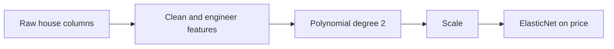

# Model card: King County house price estimator

Generated by `kc_house.train` on 2026-10-28T14:16:42+00:00 (git `8e227e0`).
Every number below comes from `metrics.json`; do not edit by hand.

## Intended use

Give a rough sale-price estimate for a house in King County, Washington, to help a
buyer or seller judge a fair price. **Not** for appraisal, lending, insurance or any
decision with legal or financial consequences.

## Data

21,597 house sales from 2014-05-02 to 2015-05-27
(one year); one implausible record is removed. Split 15,117 train /
6,479 test, seed 42. Dataset hash
`73e8f351aada`.

## Model

ElasticNet with `alpha=0.01` and
`l1_ratio=0.2`, chosen by
5-fold grid search on training data only.

## Performance (held-out test set, evaluated once)

| Metric | Value |
|---|---|
| R² | 0.845 |
| Typical error (median) | 14.8% of the price |
| Mean absolute error | $94,808 |
| RMSE | $143,443 |
| Average bias | $1,151 |

Stopping floor: held-out R² of at least 0.80. Met.

## What it beat

| Model | Role | Cross-validated R² | Test R² |
|---|---|---|---|
| `mean_baseline` | baseline | 0.000 ± 0.000 | 0.000 |
| `grade_only_linear` | baseline | 0.451 ± 0.011 | 0.432 |
| `ridge` | candidate | 0.739 ± 0.012 | not used |
| `random_forest` | candidate | 0.869 ± 0.009 | not used |
| `hist_gradient_boosting` | candidate | 0.883 ± 0.018 | not used |
| `elastic_net_poly` | production | 0.828 ± 0.012 | 0.845 |

Baselines are scored before any tuning. Other families are judged on
cross-validation only so the test set stays untouched.

## How honest is the number? (stricter splits)

| Split | R² | Mean abs error | Typical error |
|---|---|---|---|
| random (notebook) | 0.845 | $94,808 | 14.8% |
| grouped by house id | 0.835 | $96,691 | 14.5% |
| temporal (train past, test future) | 0.812 | $99,699 | 15.0% |

*Grouped* keeps the same house out of both sides (177 houses sold twice).
*Temporal* trains on earlier sales and tests on later ones, like real use.

## Where it errs (price quartiles, test set)

| Quartile | Price range | Houses | Typical error | Average bias |
|---|---|---|---|---|
| 1 | $82,000 to $320,000 | 1644 | 17.3% | $41,203 |
| 2 | $320,900 to $450,000 | 1610 | 14.1% | $23,166 |
| 3 | $450,500 to $640,000 | 1617 | 14.2% | -$6,321 |
| 4 | $640,500 to $7,060,000 | 1608 | 14.3% | -$54,324 |

## Limitations

- Prices are from 2014 to 2015; the market has moved. Treat output as relative, not
  current.
- Location features (zip code, coordinates, distances) can act as proxies for
  neighbourhood demographics. No fairness audit has been run, so do not use for
  credit or housing-eligibility decisions.
- The model pulls estimates toward the middle: cheap houses tend to be overestimated
  and the most expensive underestimated (see average bias by quartile).
- Some outliers are data problems, not model problems (the notebook found a lot with
  no house on it).

## Deep-learning gate

**Verdict: `not_warranted`.** The data is 19 tabular columns with no text or images. The best classical model (hist_gradient_boosting) reaches a cross-validated R² of 0.883 against a floor of 0.80; the spread across classical families is 0.144. The shipped model trails it by 0.056 cross-validated R²: a tuned tree ensemble is the next step before any neural network.

Revisit if: the dataset grows past roughly 1 million sales, listing text or photos are added as inputs, or classical models stop clearing the floor after retraining.
